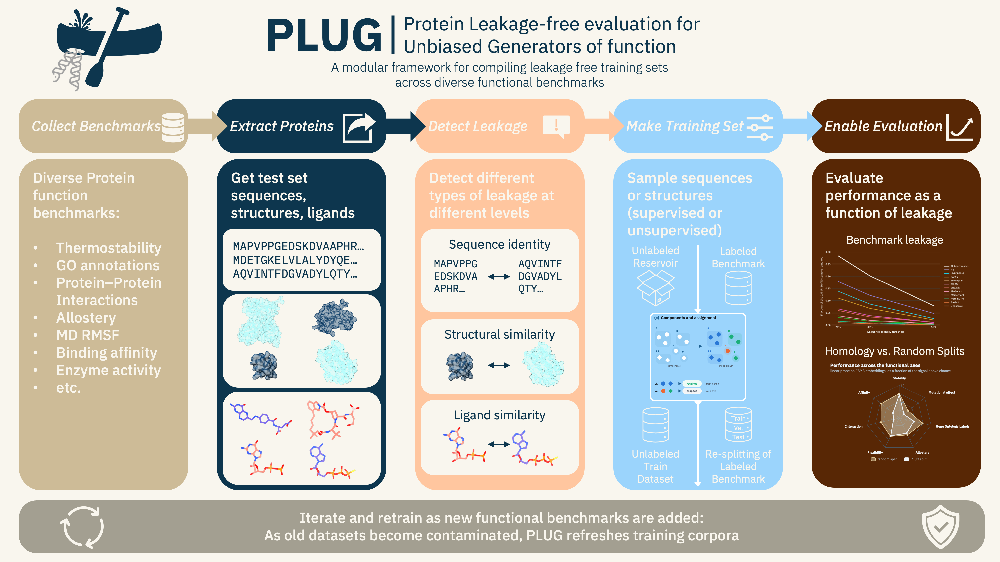

# PLUG

**Protein Leakage-free evaluation for Unbiased Generators of function.**



build a **leakage-free** training subset — sampled from a sequence reservoir (uniref90), a structure reservoir (pdb), or both — to align/train a protein model on, then test whether alignment improves prediction on mutliple functional benchmarks (megascale + fireprot ddG, proteingym dms fitness, cafa5 GO function, allobench + passerrank allosteric sites, human PPI + string, lp-pdbbind/bindingdb affinity, atlas MD per-residue RMSF, and whatever else you want).

default leakage rule: a sampled candidate is dropped if it looks like any **test** protein —
- **sequence** (`RESERVOIR=seq`, uniref90): mmseqs2 alignment over >80% of a test seq's length at >30% identity (`COV`/`MIN_ID`), so the test protein's content is present in the train seq. Run bidirectionally (union of mode 1 and 2) so that subdomains are found.
- **structure** (`RESERVOIR=struct`, pdb): foldseek TMalign at >0.5 TM-score to a test structure (`TM`), i.e. the same fold.
- **both** (`RESERVOIR=both`): a union graph over the sequence and structure hits — a candidate is dropped if its component touches a test protein in *either* view, so a seq+struct model is safe against leakage through either lens.

thresholds/params are deliberately user-defined so you can characterize generalizability as a function of how much leakage you allow.

## leakage coverage modes (`COV_MODE`)

mmseqs `--cov-mode` decides which sequence the `COV` (0.8) threshold applies to, which matters for **multidomain** proteins. for example: a 600 aa uniref protein whose 200 aa domain B equals a 200 aa test protein — the alignment covers 100% of the test but only 33% of the train seq, so `COV_MODE=1` flags it (removed) while `COV_MODE=0` keeps it.

- `COV_MODE=union` (default) — run mode 1 **and** mode 2 and drop a candidate that either one flags. a subdomain match is leakage whichever protein is the longer one, so the honest rule takes both. on a 1M uniref sample this flags 25.2% of candidates, where mode 0 alone misses 44% of that.
- `COV_MODE=1` — cover the **test** seq. drops a train seq if it covers >80% of a test protein *regardless of the train protein's length*, so it catches a long multidomain uniref protein that contains a whole test protein as one domain.
- `COV_MODE=2` — cover the **train** seq. catches the reverse (a short train protein that is a sub-domain of a longer test protein).
- `COV_MODE=0` — cover **both** seqs (>80% of each). only removes near-duplicates of similar length; it would **keep** the multidomain protein above (the test domain is <80% of the long train seq), letting a test protein leak in as a sub-domain.

this setting applies to the **trainset scan**. the homology splits always use the union, so a benchmark's splits don't change meaning when you retune the reservoir filter.

## usage pipeline
to create your own leakage-free unlabeled training set:

```
data/download_*.sh          download benchmark(s) (all of its splits) -> data/<bench>/
plug/benchmarks/<name>.py   one file per benchmark: how to read it    -> load as a torch dataset
plug/graphs.py              what is too alike to separate             -> groups that must stay together
plug/solver.py              assign whole groups to train/val/test     -> maximise retained datapoints
plug/splitting.py           the two together, plus the leakage audit  -> data/splits/<bench>__<thresholds>.csv
plug/build_unlabeled_dataset.py    sample a reservoir, drop leakers   -> trainset.fasta
```

instead of scanning a whole reservoir (~121M uniref90 seqs, or the whole pdb), the trainset builder **reservoir-samples** a batch of candidates in one streaming pass so that the reservoir is never held in memory. it checks *every* sampled candidate against the combined benchmarks (~310k sequences, all splits), keeps the clean ones, and resamples until the quota is met:

- **sequence scan** (`RESERVOIR=seq`): stream the uniref90 fasta, sample a batch, `mmseqs` them against the combined test fastas, and drop any that clear the identity + coverage cutoff.
- **structure scan** (`RESERVOIR=struct`): stream the pdb directory, sample a batch of structures, `foldseek` TMalign them against the test structures, and drop any that clear the TM-score cutoff.
- **both** (`RESERVOIR=both`): sample structures, run *both* searches on them (their sequences come straight out of the structures), and drop via a union graph — any candidate whose sequence *or* structure neighborhood reaches a test protein is removed. the result is leakage-proof for a model that sees sequence and structure together.

checking a small sample against the benchmark fastas is cheap and exact; the reservoir is never copied, only the sampled training set is written. sampling is uniform (to cover lengths and families) but could — in theory — be stratified on a feature (composition, family, fold, organism, …).

## setup

the reservoirs are downloaded separately — point `.env` at them (and at the search binaries). copy `.env.example` to `.env` and edit; `config.py` auto-loads it. then:

```bash
uv sync --extra torch --extra chem       # create .venv (torch loads the benchmarks, chem/rdkit splits on ligands)
uv pip install -e .                      # so `import plug` works from anywhere
source .venv/bin/activate                # then plain `python ...` uses the venv
for s in data/download_*.sh; do sh "$s"; done   # fetch every benchmark
```

- **sequence reservoir**: uniref90 (https://ftp.uniprot.org/pub/databases/uniprot/uniref/uniref90/), point `UNIREF_FASTA` at it. needs mmseqs2 — set `MMSEQS` (or `brew install mmseqs2`).
- **structure reservoir**: a directory of pdb/mmcif files — `sh data/download_pdb.sh` mirrors the whole pdb into `data/pdb`, point `PDB_DIR` at it. needs foldseek — grab the static build for your platform from https://github.com/steineggerlab/foldseek/releases (`foldseek-osx-universal.tar.gz`, `foldseek-linux-avx2.tar.gz`, `foldseek-linux-arm64.tar.gz`, or `foldseek-linux-gpu.tar.gz`), untar it, and point `FOLDSEEK` at the extracted `bin/foldseek`. structural leakage also needs the test-set structures in `STRUCT_TESTS` (a dir of pdb/mmcif files).
- for the gpu check, point `MMSEQS`/`FOLDSEEK` at gpu builds and set `GPU=1`.

## run

```bash
python -m plug.splitting                 # split every benchmark -> data/splits/*.csv
python -m plug.splitting shs27k ppi      # or just some of them

RESERVOIR=seq   python -m plug.build_unlabeled_dataset   # sample uniref90, drop sequence leakers
RESERVOIR=struct python -m plug.build_unlabeled_dataset  # sample the pdb, drop TM-score leakers
RESERVOIR=both  python -m plug.build_unlabeled_dataset   # sample the pdb, drop union (seq ∪ struct) leakers
```

`.env` controls it: `RESERVOIR` picks seq/struct/both, `QUOTA` is how many leakage-free seqs to collect, `OVERSAMPLE` how much extra to draw each round to cover dropped leakers, `MIN_LEN`/`MAX_LEN` bound the sampled protein length (drops fragments + giant non-physiological seqs), `MIN_ID`/`TM` are the sequence/structure leakage thresholds, `GPU=1` runs the check on a cuda gpu.

## use

needs torch (`uv sync --extra torch`), with the venv activated:

```python
from plug.benchmarks import *
from plug.build_unlabeled_dataset import Unlabeled

train = Unlabeled.from_fasta()         # {sequence, id} — the leakage-free align set (id = uniprot code)
mega  = Megascale()                   # {sequence, mutation, ddg, pdb, split} — megascale ddG
fire  = Fireprot()                    # {sequence, mutation, ddg, pdb, split} — fireprot ddG
dms   = Dms(assay="Binding")          # {sequence, mutation, score, assay, dms_id, uniprot, split}
cafa5 = Cafa5()                       # {sequence, protein_id, organism, go_bp, go_mf, go_cc, split}
allo  = Allobench()                   # {sequence, target_id, gene, organism, uniprot, pdb, allosteric_site, active_site, split}
ppi   = Ppi()                         # {sequence_a, sequence_b, id_a, id_b, label, split} — human ppi
shs   = Shs27k(mode="binding")        # {sequence_a, sequence_b, id_a, id_b, types, score, split} — STRING PPI subset
pr    = Passerrank()                  # {sequence, uniprot, gene, organism, pdb, allosteric_site, split}
lppdb = LpPdbbind()                   # {sequence, pdb, value, smiles, split} — LP-PDBBind affinity
bdb   = Bindingdb()                   # {sequence, uniprot, target_name, organism, smiles, measure, value, relation, split}
atlas = Atlas()                       # {sequence, pdb_chain, rmsf, rmsf_replicas, split} — per-residue MD flexibility (Å)
```

every residue number in every benchmark — mutation positions, allosteric sites, active sites — counts along the `sequence` sitting next to it, starting at 1, and every per-residue list (atlas rmsf) is exactly as long as that sequence. the allosteric benchmarks label their sites the way the pdb file does, so [`sifts.py`](src/plug/sifts.py) renumbers them on load and keeps only the ones that land on the residue the label named; the few it can't place are dropped rather than guessed. that needs `data/download_sifts.sh`, which the two download scripts already call.

every one of them takes `split=` and `how=`. the four that ship a split default to its **test** split; the other seven default to the **whole** benchmark (there is nothing to hold back until you split it yourself). see [benchmark splits](#benchmark-splits). `REGISTRY` maps each name to its class, for looping over all of them.

## benchmark splits

for **supervised models**, benchmarks can be broken into train/val/test splits. note that there is frequently more data available to train on in the literature. **every** benchmark takes the same two arguments. `split` picks the split you want, `how` says where it came from — published (from literature) or homology (generated here). this allows for direct comparison to literature for some benchmarks or a consistent homology splitting strategy for all benchmarks.

the three ways to load any benchmark, side by side:

```python
# 1. the whole thing as one set — nothing held back, every item labelled "test".
#    for self/unsupervised work, or when you brought your own split.
Megascale(how="whole", split="all")

# 2. the split the benchmark itself published — for comparing against its paper.
#    only four ship one (megascale, fireprot, lp-pdbbind, ppi); the rest raise.
Megascale(split="train")             # "val", "test" (the default), or "all"

# 3. an 80/10/10 homology split, built here and cached. works for all eleven.
#    reads data/<bench>/ and the .env settings, then writes data/splits/<bench>__<tag>.csv
Megascale(how="homology", split="train")
Atlas(how="homology")                # test of a fresh 80/10/10
```

3 is the one that does real work: it groups the benchmark's own proteins with the thresholds from your `.env` (`MIN_ID`, `COV`, plus `SPLIT_TM`/`TANIMOTO` where they apply) over the data in `data/`, then caches the result. the first call is slow — minutes on the big benchmarks — and every call after reads the cached csv. change a threshold and the file name changes with it, so you get a fresh split rather than a stale one.

1 and 2 are the defaults: benchmarks that publish a split default to `how="published"` and its **test** split, and the seven that don't default to `how="whole"`, so a plain `Atlas()` is the entire benchmark and a plain `Megascale()` is its published test set. `Atlas(how="published")` is a `ValueError`, never a silently invented split, and asking for a part a benchmark doesn't publish is an error too — `split="val"` never comes back as a quiet empty list.

`how="homology"` runs [`splitting.py`](src/plug/splitting.py), which is two steps.

**what is too alike to separate** ([`graphs.py`](src/plug/graphs.py)) — search the benchmark's **own** proteins against themselves with mmseqs, link any two that clear the leakage rule's bar (`MIN_ID` identity over `COV` coverage) under **either cov-mode** — mode 1 catches a hit that only covers the target, mode 2 one that only covers the query, so a protein that is a subdomain of another gets caught whichever way round it is — and take the union of both. those links are then closed transitively into **groups**: something alike something alike lands in the same group. a group is indivisible from here on.

**where the groups go** ([`solver.py`](src/plug/solver.py)) — every datapoint is reduced to the *set of groups it rides on*: one group for a single-protein measurement, two for an interaction pair, a protein and a ligand for an affinity. a datapoint is retained exactly when every group in that set lands in the same split, and it is dropped otherwise. a mixed-integer program then assigns whole groups to train/val/test, **maximising retained datapoints** subject to each split's size sitting within a tolerance of its share (±5% of what survives, by default). the proportions are of the survivors rather than of the whole benchmark because that is the only form every benchmark can satisfy: on ppi a pair is kept only when both ends agree, which caps retention near 48%, so no assignment could put 80% of *all* pairs in train.

so leakage is not penalised here, it is unrepresentable: no group is ever divided, whatever the solver decides. what the solver is actually for is the *cost* — a leakage-free split throws rows away, and how many depends entirely on which groups go where. on lp-pdbbind, dealing the groups greedily largest-first keeps 82.2% of the affinities; solving for it keeps **99.6%**, proven optimal, at the same zero leakage. on shs27k it is 43.8% against 91.3%.

the greedy dealer survives as the solver's warm start. cvxpy cannot hand a milp a starting solution, so what gets handed over is what the hint *proves*: a legal assignment keeping R rows means `retained >= R` holds at the optimum too, so it is added as a bound. it can only cut away worse answers, never the best one. built in cvxpy and solved with scip (`uv sync --extra solver`).

`splitting.audit()` is what makes any of this checkable: it re-reads the raw mmseqs / foldseek / rdkit hits — not the groups, which would be circular, since the groups are what the assignment was built from — and counts how many ended up with their two ends in different splits. for a split made here that number is zero.

a benchmark can look alike in more than one way, and the rule is the same each time: search it against itself, link anything over the bar **in either direction**, and keep whole groups of linked things together.

- **proteins** — sequence (mmseqs, both coverage modes, `MIN_ID`/`COV`) and, for a benchmark that ships structures, shape as well (foldseek TM read both ways round, `SPLIT_TM`). both describe the same proteins, so they share one graph and either kind of match holds two proteins together. **atlas** ships structures; `data/download_atlas.sh` pulls the `.pdb` alongside the RMSF table.
- **ligands** — chemistry (`TANIMOTO` on ecfp4: morgan radius 2, 2048 bits, stereochemistry ignored), for **lp-pdbbind** and **bindingdb**. the fingerprint has to be named alongside the number — the same two molecules score 0.43 on ecfp4 and 0.79 on the rdkit fingerprint, so a bare tanimoto value says nothing. a ligand is a different kind of thing from a protein, so it gets its **own** graph. putting both in one graph is what breaks: a single shared molecule chains protein to protein until the whole benchmark is one group. needs rdkit (`uv sync --extra chem`).

both graphs go into the same model, so proteins and ligands are assigned together rather than one following the other. an item is kept only when everything it is about — both proteins of a pair, or a protein and its ligand — lands in the same split. that is the rule ppi and shs27k already obeyed, so all eleven run one algorithm and no benchmark needs a special case.

`TANIMOTO` is 0.6, and that is a closure bar rather than a claim about chemistry. random pairs of these ligands top out around 0.23 (bindingdb) and 0.30 (lp-pdbbind), so 0.6 is well clear of noise — but it is stricter than the ~0.4 a chemist would call similar, and it will not link two same-class drugs that score 0.43. it has to be: the split closes links up transitively, and at 0.4 bindingdb's biggest ligand cluster is 87% of the set, too big to fit a train split at all. 0.6 is the most inclusive bar that still partitions — it triples the ligand links over 0.7 (110k against 254k on bindingdb) for two points of retention.

`SPLIT_TM` is 0.7 while the trainset's `TM` is 0.5, on purpose. a split takes the *transitive closure*: alike-to-alike-to-alike all lands together. at 0.5 every atlas chain links to ~94 others and 99.5% of the benchmark collapses into a single cluster. at 0.7 it links to ~1.5 and the split works. (foldseek's `alntmscore` normalises TM over the aligned stretch, which scores one domain inside a much longer chain as a whole-chain match — six times too many hits — so `qtmscore`/`ttmscore` are used instead.)

measured, every benchmark rebuilt from scratch and then verified against the raw mmseqs hits — not the groups, so the check can't inherit the grouping's own mistake:

| benchmark | items kept | train/val/test | protein families in >1 split |
|---|---|---|---|
| dms | 2,465,767 (100%) | 80.0 / 10.0 / 10.0 | 0 |
| megascale | 271,231 (100%) | 80.0 / 10.0 / 10.0 | 0 |
| cafa5 | 8,630 (100%) | 80.0 / 10.0 / 10.0 | 0 |
| fireprot | 3,404 (100%) | 80.0 / 10.0 / 10.0 | 0 |
| allobench | 2,257 (100%) | 80.0 / 10.0 / 10.0 | 0 |
| atlas (+ structure) | 1,938 (100%) | 80.0 / 10.0 / 10.0 | 0 |
| passerrank | 1,885 (100%) | 80.0 / 10.0 / 10.0 | 0 |
| bindingdb (+ ligand) | 75,119 / 76,866 (98%) | 85.0 / 9.9 / 5.1 | 0 |
| lp-pdbbind (+ ligand) | 19,156 / 19,443 (99%) | 85.0 / 7.5 / 7.5 | 0 |
| shs27k (pair) | 6,567 / 7,624 (86%) | 80.5 / 10.0 / 9.5 | 0 |
| ppi (pair) | 140,040 / 274,500 (51%) | 84.9 / 10.2 / 5.0 | 0 |

ppi and lp-pdbbind sit off 80/10/10 because their second solver pass — the one that lands
the sizes on target once retention is settled — returned a SolverError, so the split kept is
the retention pass's answer with the sizes wherever they fell. the three-way proportions are
of what survives. retention is a proven optimum only on bindingdb; the other three came back
`optimal_inaccurate`, so their figures are what the solver reached, not what is achievable.

the last column is the promise, and it is the strict one: **a protein family lands in exactly one split**, so a test protein was never seen in training — not under a different partner, not paired with a different ligand. that is what the dropping buys. a rule that instead keeps whole items together and lets a family span splits fills every benchmark back up to 100%, but then most families do span: 93% of ppi's would, and a model that has already met the test protein scores against itself.

these numbers were built with the mmseqs on the pod, at the thresholds this repo now defaults to. a different mmseqs build finds a slightly different hit set — 1,402 edges against 1,398 on shs27k — which reshuffles the deal without ever breaking the guarantee. build with the most sensitive search you have, and keep the split csvs.

**items kept** is the cost of the rule. when an item is about two things, both have to agree, and the ones that straddle a boundary belong to neither split so they are dropped. a split holding *x* of the proteins keeps about *x²* of the pairs, which is why the proteins are dealt at the square root of the target (59/21/21) to land the surviving pairs on 80/10/10. how much that costs depends on how the benchmark is shaped rather than on whether it pairs: ppi loses half its pairs because its proteins are densely interlinked, while shs27k — built to be under 40% self-similar in the first place — keeps 86% of them. the ligand benchmarks keep almost everything, because a ligand group follows the proteins it was measured against instead of being dealt blind.

for ppi specifically, the **published** split is the paper's own version of the same idea (divide the proteins into three blocks, keep only within-block pairs) and is far better balanced — 163,192/59,260/52,048, 50/50 positives in every split. prefer it unless you specifically want the split rebuilt at this repo's stricter identity bar.

## datasets

unique sequences per benchmark — the whole thing, every published split included, which is what
`data/formatted/<bench>.fasta` holds and what the trainset is kept clear of:

| benchmark | source | unique seqs | published split |
|---|---|---|---|
| megascale | megascale ddG (tsuboyama 2023, thermompnn split) | 271,526 | train/val/test |
| fireprot | fireprot ddG (fireprotdb, thermompnn split) | 193 | train/val/test |
| dms | proteingym DMS_substitutions | 187 | — |
| cafa5 | cafa5 GO function, temporal holdout (via bioreason-pro) | 8,528 | — |
| allobench | allobench allosteric/active sites | 425 | — |
| ppi | human ppi gold standard (figshare) | 11,019 | train/val/test |
| shs27k | STRING human PPI subset (GNN-PPI / PIPR) | 1,690 | — |
| passerrank | passerrank allosteric set (ASD) | 333 | — |
| lp-pdbbind | LP-PDBBind protein–ligand affinity | 12,718 | train/val/test |
| bindingdb | bindingdb articles, protein–ligand affinity (single-chain targets) | 2,157 | — |
| atlas | atlas MD per-residue RMSF (conformational dynamics) | 1,693 | — |

**310,469 sequences** all told (308,121 unique — ~2.3k proteins appear in more than one benchmark). the three that grew when their train splits were added: megascale 28,199 → 271,526, fireprot 53 → 193, lp-pdbbind 2,644 → 12,718. ppi always shipped all three of its blocks and the other seven publish no split, so those were already whole. megascale dominates because it counts every mutant sequence as well as every wild type — 215,731 train substitutions of 239 wild-type proteins — so it is 271k sequences of only a few hundred distinct proteins, and a candidate homologous to one of them is homologous to all of its mutants anyway.

the **published split** column is what `how="published"` will hand you. a `—` means the benchmark ships no train/val/test to select from, so `how="published"` raises. several of those seven are still distributed as evaluation-only data — cafa5 is a temporal holdout, dms and bindingdb are assay collections — and for those the whole benchmark *is* the test data, which is exactly what the default `how="whole"` gives you.

reservoirs: uniref90 (~121M sequences) and the pdb (~all deposited structures, as a directory of mmcif files).

## licenses

while this repo doesn't distribute actual data, it is important to review [`licenses/`](licenses/) for the full texts and an attribution index. all sources are freely redistributable with attribution **except atlas (CC BY-NC) and lp-pdbbind (research/non-profit only)**, which are non-commercial. the generated trainset (uniref90 CC BY + pdb CC0) is clean for any use, with attribution.

## adding a benchmark

1. add `data/download_<name>.sh` to fetch it — all of its splits, if it ships splits.
2. add `src/plug/benchmarks/<name>.py`: one class subclassing `Benchmark`, four attributes and one
   method. that's the whole contract.

```python
class Atlas(Benchmark):
    name, key = "atlas", "pdb_chain"   # key names the field holding an item's protein
    published = ()                     # ("train","val","test") if it ships a split, () if not

    @classmethod
    def rows(cls):                     # yield one dict per item, unfiltered
        yield {"sequence": ..., "pdb_chain": ...}
```

pair benchmarks set `key = ("id_a", "id_b")` and `seq = ("sequence_a", "sequence_b")`. if the benchmark ships a split, give every item its `"split"`. if it holds sequences its items don't carry (mutants, extra chains), override `sequences()` — everything it yields is held out of the trainset. if it can leak through something other than sequence, set `views = ("structure",)` or `("ligand",)` and override `structures()` (`{key: path to a .pdb}`) or `ligands()` (`{key: [smiles, ...]}`) — its split will then cover that too.
3. import it in [`benchmarks/__init__.py`](src/plug/benchmarks/__init__.py) — a benchmark missing from that list silently disappears from `REGISTRY`.
4. `python -m plug.build_unlabeled_dataset` — it writes any missing `data/formatted/*.fasta` itself, and the sample is checked against every `data/formatted/*.fasta` (and, for `RESERVOIR=struct|both`, every structure in `STRUCT_TESTS`), so the new benchmark is protected automatically. `split=`/`how=` already work.


## TODO:
- add other sampling strategies for train set (stratify on length/family/fold/organism/…)
- add more benchmarks (more conformational/functional signals)
- fetch each benchmark's test structures automatically (if available) for the foldseek check
